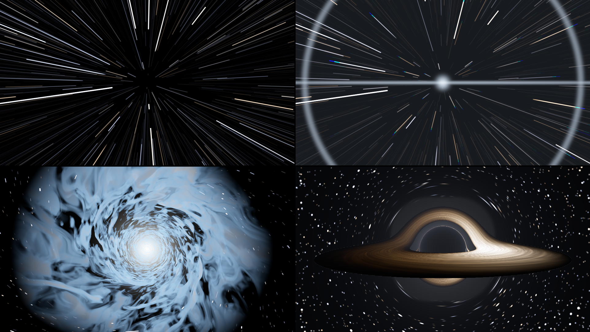
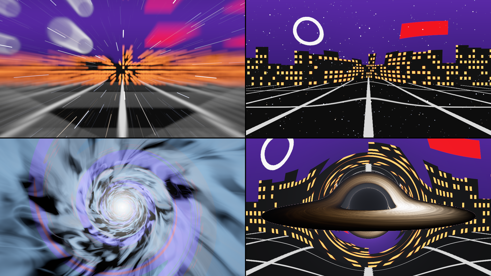

# slipstream

> **AI-assisted project.** This codebase was created with [Claude](https://claude.com/claude-code)
> (Anthropic), directed and reviewed by a human author. It has **never been loaded into
> Resolume on macOS**, where it is loaded by
> [oxbow](https://github.com/stoatworks-labs/oxbow), a real FFGL host that is not Resolume. On
> Windows the fleet's gate loads both plugins in Resolume Arena 7.27.1 on a software
> renderer, checks their controls and renders through them; no one has played a show with it.
> Everything below is measured by an offline harness that drives the real plugin classes
> in a headless GL context, on this Mac's GPU at two rasters and again on Apple's software
> renderer. `sliptest --streak` holds a star's streak to a simulation of an open shutter
> **within 1%** all along its length, and `--energy` finds a star's light the same at rest
> as stretched across a hundred pixels. The black hole's shadow lands **within 0.06 px** of
> Synge's formula, a dot behind it becomes a ring **within 0.03 px** of where the harness's
> own ray tracer puts it, and the corona's brightest ring sits on the shadow's edge although
> nothing draws it there. `sliptest --negative` re-runs the checks against twenty
> deliberately wrong models and `tools/mutate.sh` changes one character of the shipped
> shaders and code twenty-three times; every one is caught. A control sweep fails if any
> parameter does nothing.

Jumps to hyperspace, warp jumps, wormholes and a black hole for Resolume Arena/Avenue, as
two FFGL plugins: **SW Slipstream**, a source (space, with stars in it), and **SW Slip
Over**, an effect in which your clip is the view out of the front window. (Yes, a slipover
is also a knitted tank top. FFGL gives a plugin sixteen characters for its name and they
were all spoken for.)



<sub>SW Slipstream's four looks, rendered by the plugin's offline harness (`sliptest`),
not captured from Resolume: Hyperspace mid-jump, Warp in transit, the Wormhole's mouth
opening, the Black Hole held.</sub>

<!-- downloads:start -->
<!-- downloads:end -->

## The one idea

**A camera flying through space with its shutter open.** Nothing draws a streak. A star
sits at some depth and some distance off the line of flight, the camera moves on while the
shutter is open, and the star's image runs outward from the vanishing point for as long as
the shutter lets it. Speed up and the runs get longer. That's the stretching-stars jump to
lightspeed every space film has done since 1977, and it is acceleration, photographed.

What falls out of that:

- **A streak is as bright at its tail as at its head.** A star's image speeds up as the
  star gets nearer, which spreads its light thinner, and the star gets brighter by the
  inverse square, which puts it back. The two cancel, which is why the streaks in the films
  are lines rather than comets.
- **A star's light doesn't change when it streaks.** A faster star lays the same light over
  a longer line, so stretched stars go dimmer per pixel, and it's the brightest stars,
  overexposed at rest, that stay bright as lines. Real film behaves the same, which is why
  the plugin develops its exposure the way film does: bright cores burn out white and keep
  their colour at the edges.
- **Hyperspace settles into steady lines.** The star field repeats along the line of
  flight. Once the camera passes through it more than once a shutter, every star's line is
  filled end to end each frame and stops depending on speed: the steady radial lines of
  being in transit, rather than everything fading away.

The jump itself is a journey from normal space into transit and out again, and each look
has its own script for it.

## Four ways out of here

- **Hyperspace.** Stars as points, then the camera accelerates, slowly and then all at
  once, and the points stretch into streaks, a flash, the steady lines of transit and, if
  Tunnel is up, the later films'
  mottled tunnel, smeared along the line of flight by the same shutter. Dropping out is the
  same in reverse: the lines shrink back to points. In the Over, your clip is a picture
  riding ahead of the ship and its light smears inward as a star's would, so a
  bright point in the clip becomes an evenly lit line and the picture streaks into
  hyperspace with everything else. (The one cheat: the picture never gets any nearer. It
  cruises with you, too, so it only smears in a jump.)
- **Warp.** The rubber band: space ahead is drawn in towards the vanishing point, inner
  parts first, then it snaps, with a flash, a ring and a horizontal streak of light out of
  the vanishing point, and you're at warp, slower than hyperspace, stars flying past one by
  one with their colours split along them. Arriving is the flash again and the picture
  bursting back out of the vanishing point to full size, overshooting a bit and settling.
  In the Over it's your clip that stretches, snaps away into the distance and comes back.
- **Wormhole.** A whirlpool of cloud. One fondly remembered British sitcom's model unit
  made its wormhole from whipped-up cloud footage (their own effects guide says so), and
  that's the look here, not a neon tube: the picture twists into a vortex round the
  vanishing point, a mouth of cloud opens and swallows the frame, three layers of swirling
  cloud rush past lit from the far end, and you leave through a white-out at the end of the
  tunnel. In the Over your clip twists into the whirlpool and colours the clouds.
- **Black Hole.** A Schwarzschild black hole, done properly. You can't see an event
  horizon; what you see is its **shadow**, the patch of sky where any light reaching you
  would have had to come out of the hole (so none does), and it's about two and a half
  times the horizon's size. Light from everything else is bent round it, so the stars (or, in the
  Over, your clip) are lensed into arcs and an Einstein ring, and every star appears twice.
  The **accretion disc** is a thin, hot, Keplerian disc whose far side is lensed up over
  the top of the shadow and under it; its light is a blackbody seen through the Doppler and
  gravitational shifts, so the side coming towards you is bluer and far brighter (Doppler
  at 0 switches that off, as the people who made a well-known black hole film did on
  purpose). The **corona** is a faint glow round the hole, added up along each bent ray,
  and the rays that skim the hole's photon sphere wind round it and pass through the most
  of it, so a bright thin **photon ring** appears at the shadow's edge with nothing drawing
  it. The journey brings the hole in from far away, and leaving is the plunge: the shadow
  grows until it is the whole sky, then you come out of a white hole on the other side.
  (The plunge past the photon sphere and the white hole are cheats. What's on the other
  side of a black hole is not, as far as anyone knows, your next clip.)



<sub>SW Slip Over on the harness's night-city card, one tile per look. Rendered by `sliptest`.</sub>

## Getting there and back

**Drive** decides how you travel:

- **Hold**: switch Engage on and it jumps and stays in transit; switch it off and it comes
  back out. A jump you change your mind about halfway carries on through and out rather
  than running backwards.
- **Trip**: each press of Jump is a round trip: in, Transit Time there, out.
- **Loop**: round trips for ever, Cruise Time between them. The default, so dropping it on a
  layer shows you what it does inside ten seconds.
- **Fader**: Journey is the trip. 0 is normal space, 0.5 is in transit, 1 is normal space
  again, and you can scrub it either way. The trip is a circle: a jump back of more than half
  a trip has gone round, so a ramp that loops from 1 back to 0 just carries on into the next
  trip.

## Controls

- **Journey:** Look (*Hyperspace*, *Warp*, *Wormhole*, *Black Hole*), Drive (*Hold*,
  *Trip*, *Loop*, *Fader*), Engage, Jump, Journey, Entry Time, Transit Time, Exit Time,
  Cruise Time (0.2 to 20 seconds each).
- **Flight:** Cruise Speed (how fast the stars drift in normal space; 0 holds them still),
  Top Speed (the look's speed in transit, a tenth to ten times), Heading X and Heading Y
  (where the vanishing point is), Field of View (20° to 120°; the star field fills any view,
  but wider spreads the same stars further out, so they are dimmer; it also changes the black
  hole's sky, the tunnel and the clouds, and brings the camera nearer the black hole, since
  Hole Size is a share of the frame), Shutter (0° to 360°: longer streaks, same light).
- **Light:** Stars (0 to 20,000), Star Colour (white to each star's blackbody colour),
  Exposure (±4 stops), Flash, Tint (the tunnel, the clouds, the warp flash).
- **Hyperspace:** Tunnel. **Warp:** Stretch, Dispersion. **Wormhole:** Swirl (how far the
  whirlpool turns, and how fast the clouds spin), Clouds.
- **Black Hole:** Hole Size (the shadow, as a share of the frame), Disc, Disc Tilt (face on
  to edge on), Disc Size, Disc Heat (2,000 to 40,000 K at its hottest), Doppler, Corona.
- **Clip** (the Over only): Clip Depth (how far ahead the clip rides: nearer smears more),
  Clip Through (how much of the clip you can still see in transit), Mix.

The source is transparent where space is empty, so it layers over whatever's below it.
The black hole's shadow and disc are opaque.

## Status

**v0.1.0, 25 October 2026: the first release.**

### Measured offline, on macOS

`tools/verify.sh` passes on this machine (Apple M4 Max, macOS 26.4.1) against a fresh
universal Release build (25 October 2026, 14 minutes). It runs every picture check at **two rasters**,
1280×720 and 320×180, and all but four of them again on **Apple's software renderer** at
320×180. What it establishes:

| check | result |
| --- | --- |
| `--streak` | one star in flight, streaks of 145 and 36 px: light per unit length against a simulated open shutter (400,000 instants, every copy of the star's column) worst **0.9%** (bound 2%); the streak's whole light within **0.06%** |
| `--energy` | one star at rest and at three speeds, streaks up to 108 px: its whole light against its flux through the shutter, worst **0.11%** (bound 0.5%) |
| `--copies` | 1.5 and 2.5 passes of the field a shutter: the light along the line against the simulated periodic field, worst **0.44%** (bound 2%) |
| `--identity` | the Over at rest, all four looks, both rasters, Stars 0 and the default Cruise Speed: **0 of 3,686,400** channels different in 8 bits; a hair into a jump (a smear of 0.07 px at the corners) the clip keeps **90%** of its gradient energy (bound 80%; the mip floor this release removed kept 40%) |
| `--smear` | a point of the clip under hyperspace's smear in a jump (k = 2.67): the line it becomes holds **28.05** of exposure against the predicted A / k = **28.07**, evenly lit to **0.1%**; cruising at 2 D/s with the shutter wide open smears **none** of it |
| `--journey` | Hold, Trip and Loop each within a frame of their timings, J never backwards, a jump abandoned halfway carried through and out; Trip comes back from every Transit Time of a whole number of frames, 0.2 to 5 s, at 60, 50 and 30 fps (675 of them); Loop leaves within a frame of every Cruise Time the slider gives (3,003 of them); under the Fader a jump back of more than half a trip has gone round, so a looping ramp's wrap from 0.99 to 0 flies a hundredth forward |
| `--clock` | the host's clock at 499,000 s sent in milliseconds: every frame's step within **3.7e-9** of a sixtieth of a second's flight |
| `--geodesic` | the orbit table's deflection against the weak-field series to third order within **2.6e-4** (b = 200 to 5000), against Bozza's strong-deflection limit within **5e-6 rad** at b / b_c − 1 = 1e-6 (2.1 turns round the hole), and against a quadrature of the first integral within **8.1e-6 rad**; it reaches b = 268,342, past every ray of the approach (100,001) |
| `--planck` | the blackbody colours within **0.0031** of the Planckian locus (Kang et al.) in CIE 1960 uv at 2000 K and under 0.001 from 3000 K up (bound: ANSI C78.377's ±0.006) |
| `--shadow` | the black disc's radius within **0.06 px** of Synge's asin( √27 √(1 − 2/d) / d ), two hole sizes, both rasters |
| `--einstein` | a dot straight behind the hole: the ring's radius within **0.03 px** of where the harness's own RK4 ray puts it (the weak-field √(4/d) is 7% short at this distance) |
| `--disc` | Doppler 0 mirror-symmetric to the last bit; Doppler 1, the side whose velocity approaches the camera (from the geometry) is **18 times** the brighter and the bluer; face on, the disc's light along a radius against the harness's own rays, Shakura–Sunyaev and √(1 − 3/r) within **0.32%** (bound 3%) |
| `--ring` | the corona against the harness's own integral along its own rays, worst **0.51%** (bound 4%); its brightest ring **100 px** from the vanishing point, the shadow's edge **100.4 px**: the photon ring, drawn by nothing but the path length |
| `--approach` | the Over at the start of the black hole's approach (100,000 and 70,000 GM/c² off, Field of View 120°): wherever the hole bends light by under a tenth of a pixel, the clip comes back to **0.43–0.79** levels in 255 on average (bound 1; GPU only) |
| `--chord` | the Wormhole on its way out: every streak whose ends the whirlpool turns over 0.8 rad apart is gone, every one under 0.2 rad whole to 1e-6 |
| `--plunge` | the frame that crosses the white hole 99% of the way through: a median **0.03** of plain space's light (black for the shutter's share before the crossing) |
| `--seam`, `--resize`, `--state` | no seam where atan's branch cut runs through the clouds; a change of raster mid-flight is **bit-identical** to a fresh run; the host's GL state comes back, both plugins, every look |
| `--pipe` | both plugins: 2.5 frames in, exactly 2 out; a closed stdout (`\| head -c 1`) exits 1, not 141 |
| `--negative` | **20** deliberately wrong models, **20** caught |
| mutation | **23** one-character mutants of the shipped GLSL and C++, **23** caught |
| `tools/sweep.py` | all **67** controls with pixels (32 and 35) measurably change the picture |
| shaders | all 6 compile through `glslc`, not merely through Apple's driver |
| the bundles | both universal (`x86_64 arm64`), export `plugMain`, ad-hoc sign; `oxbow` reports `SW Slipstream` / `SR01` / `source` and `SW Slip Over` / `SR02` / `effect` and renders through both |

**Cost** on this Mac's GPU (`sliptest --bench`, median ms a frame, each frame timed with `glFinish`):

| plugin | moment | 720p | 1080p | 4K |
| --- | --- | --- | --- | --- |
| SW Slipstream | Hyperspace, normal space | 0.34 | 0.58 | 1.93 |
| SW Slipstream | Hyperspace, in transit | 0.56 | 1.05 | 3.53 |
| SW Slip Over | Hyperspace, jumping | 0.71 | 1.26 | 4.51 |
| SW Slip Over | Warp, the rubber band | 0.63 | 1.02 | 3.64 |
| SW Slipstream | Wormhole, in transit | 1.46 | 2.93 | 10.85 |
| SW Slip Over | Black Hole, held | 0.79 | 1.50 | 5.12 |

The Wormhole is the expensive one: its clouds are three layers of domain-warped noise a pixel.

### In Resolume, on Windows

The fleet's Arena gate (`plugin-bench`, on win-lab: Resolume Arena 7.27.1 under Mesa's
llvmpipe software renderer) takes the Windows build: both DLLs load, both plugins register
(`SR01` a source, `SR02` an effect) and appear in Arena's lists, all 37 and 41 controls match
their names, order, types, ranges and defaults, the names at FFGL's 16-character limit come
through whole, each renders a frame with content, and 18 and 22 controls visibly move the
picture in a still (the rest need a look or a moment of the journey to act, or, like the
timings, act only over time). Arena logged no shader errors and survived the run: 15
passed, 0 failed, 2 skipped. Nobody has played a show with it.

### Not tested, and limits

It has never been loaded into Resolume on macOS, and no GPU but this Mac's (Apple M4 Max)
and Mesa's llvmpipe has run it. The looks were judged by eye on harness renders, not
against footage. The black hole doesn't spin (Schwarzschild, not Kerr), and everything
nearer it than the photon sphere is a cheat. In the Wormhole a streak whose two ends the
whirlpool turns apart fades rather than being drawn as the straight line it would be, and at
the default Top Speed its clouds boil at the frame's edges in transit (a tenth of Top Speed
steadies them). With Tunnel up and a short shutter, the tunnel's noise rings at the
vanishing point. There is no OpenFX port and no presets, and no beat sync: to jump on the
beat, map Jump to a beat in Resolume.

## Build

Needs CMake 3.15+, a C++17 compiler and the FFGL SDK submodule:

```bash
git submodule update --init --recursive
```

```bash
cmake -B build -DCMAKE_BUILD_TYPE=Release
```

```bash
cmake --build build -j8
```

```bash
cmake --install build
```

The last one puts both bundles into `~/Documents/Resolume Arena/Extra Effects`. The macOS
build is universal (Apple Silicon and Intel). On Windows, GLEW comes from vcpkg
(`vcpkg.json`).

## Building and testing

The harness is `build/sliptest`. `./build/sliptest --help` lists everything; the ones you
will want:

```bash
./build/sliptest --out /tmp/frame.png --set "Look=Black Hole" --set Drive=Fader --set Journey=0.5
```

```bash
./build/sliptest --over --out /tmp/over.png --set Look=Warp --set Drive=Fader --set Journey=0.3
```

```bash
tools/verify.sh
```

`tools/verify.sh` is everything: shader hygiene, `glslc`, a fresh universal build with no
warnings, both bundles through `lipo`, their plists and an ad-hoc signature, `oxbow`
loading both, every check at two rasters and most of them on Apple's software renderer,
the negative controls, the mutants, the sweep and the bench. `CLAUDE.md` lists what each
check measures; `AGENTS.md` says why the plugin is built the way it is and what went wrong
on the way.

## License

MIT. See [LICENSE](LICENSE) and [ATTRIBUTIONS.md](ATTRIBUTIONS.md).

<!-- attributions:start -->
This project is built on other people's work — see [ATTRIBUTIONS.md](ATTRIBUTIONS.md).
<!-- attributions:end -->
