# Slipstream user guide

Slipstream is **jumps to hyperspace, warp jumps, a wormhole and a black hole, for
[Resolume](https://resolume.com) Arena and Avenue**, as two FFGL plugins in one download:
**SW Slipstream**, a source (space, with stars in it), and **SW Slip Over**, an effect in which
your clip is the view out of the front window. (A slipover is also a knitted tank top. FFGL gives a
plugin sixteen characters for its name, and the sensible ones were taken.)

Nothing in it draws a streak. It's a camera flying through a field of stars with its shutter open,
and the streaks are what a real camera would record: each star's image running outward from the
vanishing point for as long as the shutter stays open, longer the faster you go. Speed up from rest
and the points stretch into lines, which is the jump to lightspeed every space film has done since
1977, and it turns out to be nothing more mysterious than acceleration, photographed. On top of
that camera sit four scripted trips, the four **Looks**: Hyperspace, Warp, Wormhole and Black Hole.
The black hole is the physics one. Its shadow, the bent sky round it, the disc lensed up over the
top and the thin bright ring on the shadow's edge all come from light following the paths general
relativity says it takes round a black hole that isn't spinning.

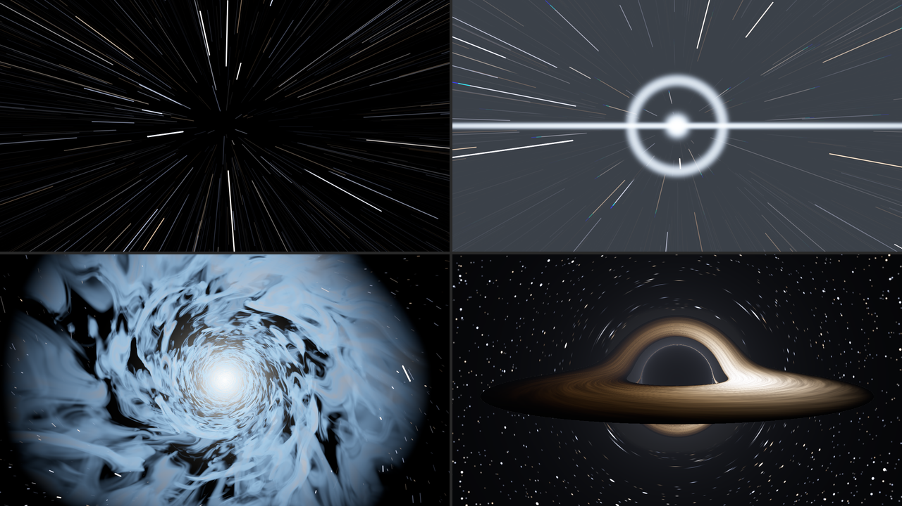

*SW Slipstream's four looks at its defaults, rendered by `sliptest`, the offline harness, rather
than captured from Resolume. Top left, Hyperspace a third of the way in (Journey 0.35). Top right,
Warp a moment after the snap (0.35). Bottom left, the Wormhole's mouth of cloud swallowing the frame
(0.20). Bottom right, the Black Hole held in transit (0.5), its right-hand side, which is coming
towards you, the brighter. Each panel is a whole 1280 × 720 frame at half size.*

> **Before you rely on this:** it's at **v0.1.0**, the first release, and early days. Everything
> below was measured offline by a harness (`sliptest`) that drives the plugins' own classes in a
> headless GL context, and `tools/verify.sh` passes on macOS 26.4.1 on an Apple M4 Max, running its
> picture checks at 1280×720 and 320×180 on the GPU and again on Apple's software renderer. A
> star's streak lays its light along its length to within 1% of a simulated open shutter, and a
> star's whole light is the same at rest as stretched into a line. The black hole's shadow lands
> within 0.06 px of Synge's formula for its size, a dot straight behind the hole becomes an
> Einstein ring within 0.03 px of where the harness's own ray tracer puts it, and the corona's
> brightest ring sits on the shadow's edge although nothing draws it there. As a hole comes in from
> far away, the Over's clip matches the clip itself to within a level in 255 on average wherever the
> hole bends it by less than a tenth of a pixel. Twenty models broken on purpose and twenty-three
> one-character changes to the shipped code are all caught, and all 67 controls (32 in the source,
> 35 in the Over) change the picture. The only host it's been run in on a Mac is the fleet's own
> test host, `oxbow`, so it has **never been loaded into Resolume on macOS**.
>
> **On Windows it has been in Resolume.** In Arena 7.27.1 on win-lab (a virtual machine with
> software rendering and no GPU), both plugins load and register as `SW Slipstream` and `SW Slip
> Over`, every control is as declared, both render, and Arena's log stays clean: all of the fleet's
> Arena checks that can run there passed, three times, the last on this release's own Windows
> download. Each control is
> measured against a still picture, so the ones that only act over time (Engage, the four times and
> Flash) can't show there, and others need the right look or moment of the trip first: 18 of the
> source's controls changed the picture outright and 21 or 22 of the Over's, with the rest needing a
> precondition the gate sets or too close to call in a still. Software rendering says nothing about
> a GPU, or about speed.
>
> The looks were judged by eye on the harness's renders, not compared with anyone's footage, and
> the only clip the Over has been measured on is the harness's own test card. The Wormhole's
> clouds flicker at the frame's edges in transit at the default Top Speed; that and the other
> things I know it doesn't do well are under *Known limits*. Try it on a spare layer before you
> put it in a show.
>
> This codebase was created with AI assistance, directed and reviewed by a human author.

---

## Installing

Every download has both plugins in it: **SW Slipstream** (a source) and **SW Slip Over** (an
effect), as `Slipstream.bundle` and `Slipstream Over.bundle` on macOS and `Slipstream.dll` and
`Slipstream Over.dll` on Windows. Get them from the
[`v0.1.0` release on GitHub](https://github.com/stoatworks-labs/slipstream/releases/tag/v0.1.0)
or the [project page](https://stoatworks-labs.com/software/slipstream/), drop both into
Resolume's effects folder and restart Resolume:

```
macOS    ~/Documents/Resolume Arena/Extra Effects/
Windows  %USERPROFILE%\Documents\Resolume Arena\Extra Effects\
```

Avenue uses the same layout under its own folder name. SW Slipstream shows up among the sources and
SW Slip Over in the effects browser.

The macOS download is a universal build (Apple silicon and Intel), as a `.dmg` or a `.zip`. It's
**Developer ID-signed and notarised** by the release pipeline after publication, so the bundles
just load. If macOS refuses a download, it's from before the signing, so download it again. The
Windows download is an x64
installer (`-setup.exe`) or a `.zip`. It isn't code-signed, so the installer trips SmartScreen
once: **More info** → **Run anyway**.

---

## Start here

1. Put **SW Slipstream** in a clip slot and trigger it. Stars drift slowly towards you, and three
   seconds later comes the first jump: the points stretch into streaks, there's a flash, and you're
   in hyperspace, steady radial lines inside a mottled blue tunnel. Three seconds after that you
   drop out with another flash, and the lines shrink back to points. It goes round every nine and a
   half seconds, because **Drive** starts on *Loop*.
2. Change **Look** to *Warp* and wait for the next jump. Space is drawn in towards the middle, then
   snaps with a flash, a ring and a horizontal streak, and the stars fly past one at a time.
3. Change **Look** to *Wormhole*: the stars twist into a whirlpool, a mouth of cloud opens and
   swallows the frame, and you leave through a white-out at the far end.
4. Change **Look** to *Black Hole*: a black hole comes in from far away, its golden disc fading up as
   it arrives, sits there for three seconds, and then you fall into it and come out of a white hole.
5. Set **Drive** to *Fader* and move **Journey** by hand: 0 is normal space, 0.5 is in transit, 1 is
   normal space again, and you can scrub either way. It's the quickest way to see what each look
   does, a bit at a time.
6. For your own footage, put **SW Slip Over** on a clip. Your clip is the view out of the window,
   and every look does its trip to it.

---

## A camera with its shutter open

The source is a box of a few thousand stars at random places and depths, repeating along the line of
flight forever, and a camera flying through it. As the camera moves on, each star's image runs
outward from the vanishing point, and the shutter, open for half of each frame at the default 180°,
records that run as a streak. That's all that's going on, and the rest falls out of it:

| what you see | why |
| --- | --- |
| **points at rest, streaks at speed** | a streak is as long as the distance the camera flew while the shutter was open |
| **streaks as bright at the tail as at the head** | a star's image speeds up as it nears, spreading its light thinner, and the star brightens by the inverse square as it nears, putting the light back; the two cancel |
| **streaks dimmer than the stars were** | a star lays the same light along a longer line; the brightest stars, burnt out white at rest, are the ones that stay bright as lines |
| **steady radial lines in transit** | once the camera flies through the repeating box more than once per shutter, every star's line is filled end to end every frame and stops changing with speed |
| **white cores with coloured edges** | the picture is developed the way film is, so a star's middle burns out white and its colour shows at the fringes |

The harness holds the second and third rows to measurements: the light along one star's streak is
within 1% of a simulated open shutter, and a star's whole light is the same at rest and at three
speeds to about a tenth of a percent.

Because everything is added up as exposure and only developed into a picture at the end, a flash
over a star field washes it out the way an overexposed frame does. A clip in the Over is turned into
exposure on the way in and back on the way out, so with nothing happening (and Stars at 0) it comes
out as it went in.

---

## The trip

Every look runs the same trip, and **Journey** is where you are on it: 0 is normal space, 0.5 is in
transit, 1 is normal space again. Each look has its own script for the way there and back, so the
same point on the trip is a different moment in each (the tables under each look say what's where).
Going in, 0 to 0.5, takes **Entry Time**. Leaving, 0.5 to 1, takes **Exit Time**. In between you
can stay in transit as long as you like.

**Drive** decides how you get round:

- **Hold**: switch **Engage** on and it goes in and stays in transit; switch it off and it comes back
  out. Change your mind halfway in and it carries on into transit and straight back out, rather than
  running the film backwards.
- **Trip**: each press of **Jump** is one round trip: in over Entry Time, **Transit Time** there, out
  over Exit Time. A press while a trip is under way does nothing.
- **Loop** (the default): round trips forever, with **Cruise Time** in normal space between them. At
  the defaults that's three seconds cruising, two going in, three in transit and a second and a half
  coming out, so the first jump starts three seconds in and it's home at nine and a half.
- **Fader**: **Journey** is the trip, scrubbed by hand, either way, as fast as you like.

Engage only does anything under Hold, Jump only under Trip, Cruise Time only under Loop and Journey
only under Fader, and in Fader none of the times apply: you're the clock. Under Hold, Trip and Loop
the trip only ever moves forwards. Under Fader it follows Journey wherever you push it, forwards as
far as you like and backwards up to half a trip, flashes included: drag Journey back through a flash
point and the flash fires on the way back, too. A move back of more than half a trip counts as going
on round, since 1 is the same place as 0. So a ramp on Journey that loops from 1 back to 0 carries
straight on into the next trip, and Journey set straight from 0 to 0.76 flies forwards through the
entry, transit and both flashes in one frame.

You can change **Look** at any point, and the new look picks up at the same place on the trip, which
in transit is a straight cut from one transit to the other. **Changing Drive** carries on from where
the trip is: switch from Fader to Hold with Engage off while you're in transit, and it leaves.

---

## Hyperspace

Stars as points, then the camera accelerates, slowly and then all at once, and the points stretch
into streaks. At full speed there's a short flash and you're in transit: steady radial lines and,
with **Tunnel** up, a mottled tunnel round them, smeared along the line of flight by the same
shutter. Dropping out is the same backwards, but more abruptly: another flash, the speed falls away
at once, the last of it bleeds off, and the lines shrink into points.

| Journey | what you see |
| --- | --- |
| 0 | normal space: stars drifting at Cruise Speed |
| 0.05 to 0.4 | the camera accelerates and the points stretch into streaks |
| 0.375 to 0.5 | the tunnel fades up |
| 0.4 | full speed, and the first flash |
| 0.5 | in transit: steady lines and the tunnel |
| 0.5 to 0.575 | still at full speed, the tunnel fading |
| 0.575 | dropping out: the second flash, and the speed falls |
| 0.575 to 0.775 | the streaks shrink back to points |
| 1 | normal space |

At 180° and 60 fps the camera flies through the box of stars one and a half times per shutter in
transit, which is what keeps the lines steady. With **Top Speed** below about 0.41 they break into
separate streaks with gaps between them.

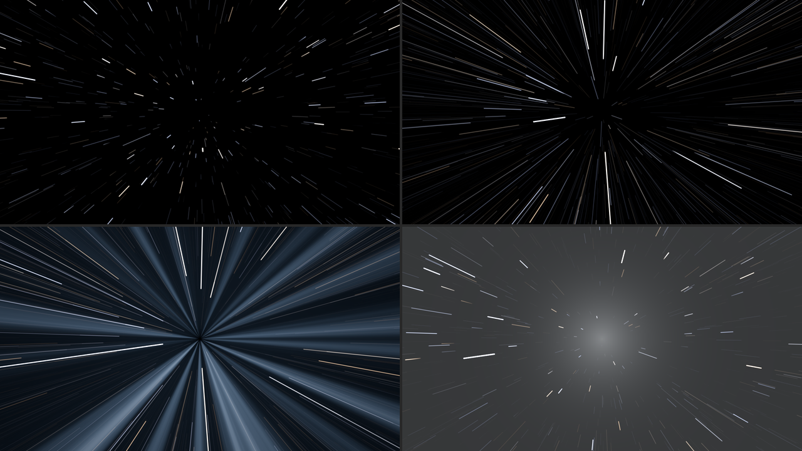

*Hyperspace, SW Slipstream at its defaults, rendered by `sliptest` rather than captured from
Resolume. Top left, Journey 0.25: the points have become short streaks. Top right, 0.35, a moment
before the flash. Bottom left, 0.5, in transit: the steady lines and the tunnel. Bottom right, 0.66,
dropping out: the streaks shrinking back to points under the fading drop-out flash. Each panel is a
whole 1280 × 720 frame at half size.*

---

## Warp

The rubber band. Space ahead is drawn in towards the vanishing point, the middle first and the
edges held, harder every moment. Then it snaps: a flash at the vanishing point with a bright core, a
ring running out from it and a horizontal streak across the frame, and you're at warp. Warp is
slower than hyperspace, so stars fly past one by one rather than as steady lines, with their colours
split along them. Arriving is the flash again and the picture bursting back out of the vanishing
point to full size, overshooting a bit and settling, like something on the end of a spring.

| Journey | what you see |
| --- | --- |
| 0 to 0.325 | the rubber band: the middle of the picture drawn in, harder and harder |
| 0.325 | the snap: the flash, the ring and the streak, and the speed jumps |
| 0.325 to 0.345 | in the Over, the clip shrinks away into the vanishing point |
| 0.35 to 0.65 | at warp |
| 0.65 | arriving: the flash, and the speed drops to nothing |
| 0.65 to 1 | in the Over, the clip bursts back out, overshoots and settles |

In the source the rubber band is only the stars crowding in towards the middle, which is subtle. It
shows properly in the Over, where it's your picture being pulled.

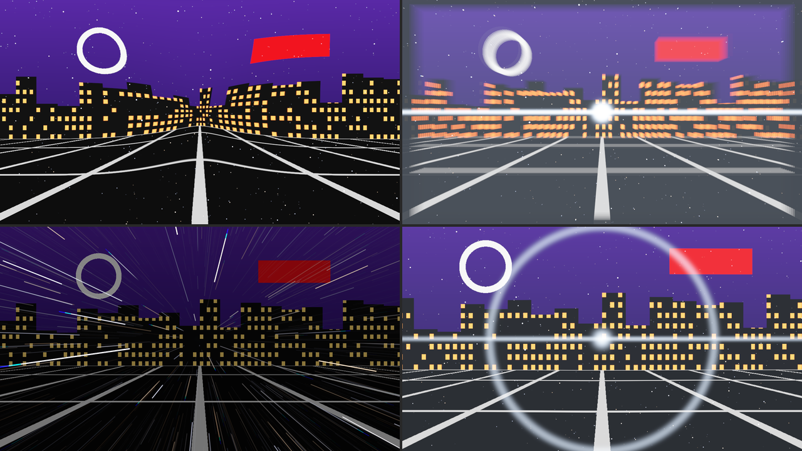

*Warp in SW Slip Over on the harness's night-city card, at its defaults, rendered by `sliptest`
rather than captured from Resolume. Top left, Journey 0.30, the rubber band. Top right, 0.33, the
snap: the city shrinking into the vanishing point under the flash. Bottom left, 0.5, at warp, with a
quarter of the clip still showing (Clip Through 0.25). Bottom right, 0.76, arriving: the city
overshooting to a little bigger than the frame. Each panel is a whole 1280 × 720 frame at half
size.*

---

## Wormhole

A whirlpool of cloud. One fondly remembered British sitcom's model unit made its wormhole from
whipped-up cloud footage (their own effects guide says so), and that's the look here rather than a
neon tube. The picture twists into a vortex round the vanishing point, a ragged mouth of cloud opens
in the middle and swallows the frame, and three layers of swirling cloud rush past, lit from the far
end, with gaps showing the layer behind and, behind the last, the dark. Towards the end of transit
the light at the far end grows until it fills the frame, and you leave through the white-out: a
flash, then the white fading evenly away as the picture unwinds out of the whirlpool and the speed
falls.

| Journey | what you see |
| --- | --- |
| 0 to 0.3 | the picture twists into the whirlpool |
| 0.075 to 0.325 | the mouth of cloud opens and swallows the frame |
| 0.15 to 0.4 | the speed comes up |
| 0.5 | in transit: the clouds |
| 0.575 to 0.75 | the light at the end of the tunnel grows to fill the frame |
| 0.75 | the white-out: a flash, and the clouds are gone |
| 0.75 to 0.85 | the white fades evenly away (about 16 frames at 60 fps, at the default Exit Time) |
| 0.75 to 1 | the picture unwinds, the speed falling to nothing by 0.9 |

The clouds are coloured by **Tint** and, in the Over, by your clip as well, as much as **Clip
Through** says. The whirlpool pulls in picture from beyond the frame's edges, and there isn't any
there, so in the Over the corners of a twisted clip are space: black, with stars.

The stars are the Wormhole's one cheat. A streak is drawn as a straight line between where the
star was when the shutter opened and where it was when it closed, each end turned by the
whirlpool. Where the whirlpool turns the two ends a long way apart, that straight line would
cut across the frame nowhere near the star's real, curved path, so those stars fade out instead.
It mostly happens fast and near the vanishing point, going in and coming out.

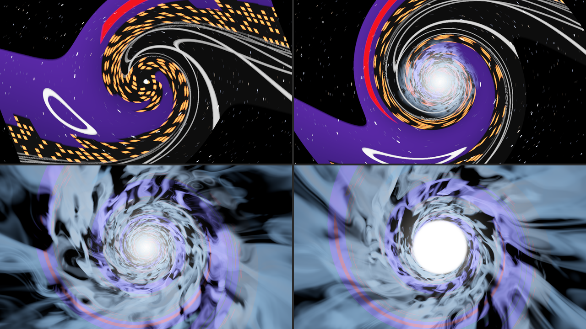

*The Wormhole in SW Slip Over on the night-city card, at its defaults, rendered by `sliptest` rather
than captured from Resolume. Top left, Journey 0.10, the city twisting into the whirlpool. Top right,
0.15, the mouth opening. Bottom left, 0.5, in transit, the clouds taking a quarter of their colour
from the city. Bottom right, 0.66, the light at the end of the tunnel growing. Each panel is a whole
1280 × 720 frame at half size.*

---

## Black Hole

A black hole that doesn't spin (a Schwarzschild black hole, for the physicists), done properly.

You can't see an event horizon. What you see is its **shadow**: the patch of sky where any light
reaching you would have had to come out of the hole, so none does, about two and a half times the
size of the horizon itself. Light from everything else is bent round the hole, so the sky behind it
(stars in the source, your clip in the Over) is pulled into arcs, a point straight behind it becomes
a ring, and every star appears twice. The camera holds still, and the sky is at infinity rather than
the box of stars the other looks fly through, so Cruise Speed, Top Speed and Shutter make no
difference here.

The **accretion disc** is a thin, hot disc of gas going round the hole, faster nearer in. Its far
side is lensed up over the shadow and under it, which is why it looks like a hat brim bent round the
hole. Its light is a blackbody seen through two shifts, the Doppler shift of gas moving towards you
or away and the shift of light climbing out of the hole's gravity, so the side coming towards you
is bluer and far brighter (eighteen times the brighter, in the harness's check). The makers of one
well-known black hole film switched the Doppler part off for theirs (James, von Tunzelmann, Franklin
and Thorne, Class. Quantum Grav. 32 (2015) 065001), and **Doppler** at 0 does the same.

The **corona** is a faint glow round the hole, added up along each bent ray. Rays that skim the hole
wind round it, sometimes more than once, and pass through more of the glow than any others, so a
thin bright ring appears on the shadow's edge with nothing drawing it: the **photon ring**.

The trip brings the hole in from a long way off, its disc fading up as it arrives. Leaving is the
plunge: the shadow grows until it's the whole sky, the picture fades to black, and you come out of a
white hole, a disc of light opening out of the vanishing point. The plunge past the photon sphere
and the white hole are cheats. What's on the other side of a black hole is not, as far as anyone
knows, your next clip.

| Journey | what you see |
| --- | --- |
| 0 | normal space: the sky (or your clip, untouched), and no hole |
| 0 to 0.5 | the hole comes in from far away |
| 0.15 to 0.45 | the disc and the corona fade up |
| 0.5 | held, with the shadow at Hole Size |
| 0.5 to 0.8 | the plunge: the shadow grows to fill the frame |
| 0.71 to 0.8 | the picture fades to black |
| 0.8 | the white hole, and normal space |

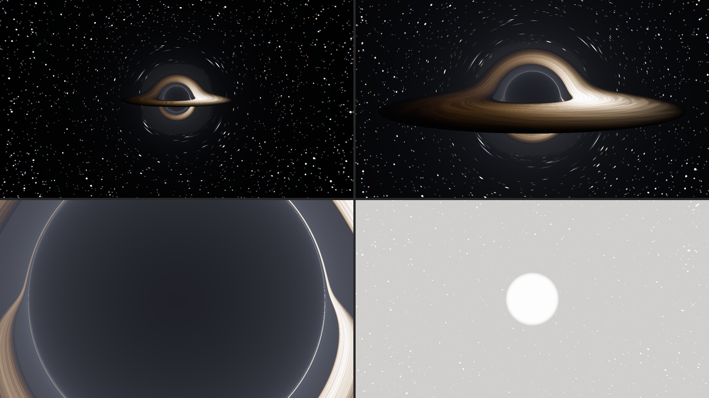

*The Black Hole, SW Slipstream at its defaults, rendered by `sliptest` rather than captured from
Resolume. Top left, Journey 0.40, on its way in. Top right, 0.5, held. Bottom left, 0.61, the plunge:
the shadow nearly fills the frame, lit faintly by the corona in front of it. Bottom right, 0.82, the
white hole opening. Each panel is a whole 1280 × 720 frame at half size.*

---

## SW Slip Over: your clip is the view ahead

The Over runs the same trips with your clip as the view out of the window:

- **Hyperspace.** The clip is a picture riding ahead of the ship, **Clip Depth** away, and its light
  smears inward towards the vanishing point the way a star's does: a bright point becomes an evenly
  lit line, and the whole picture streaks into hyperspace with everything else. (The one cheat is
  that it never gets any nearer, or it would fly past the camera and be gone. It cruises along with
  you, too, so Cruise Speed doesn't smear it; only a jump does.) Beyond the frame the
  picture carries on in mirror image, so the frame's own edges never get drawn into the streaks. As
  the tunnel comes up, the clip fades to **Clip Through**.
- **Warp.** The rubber band pulls your picture in, the snap shrinks it away into the vanishing point,
  and arriving bursts it back out. While it's gone, Clip Through's worth of it stands still behind
  the streaks.
- **Wormhole.** Your clip twists into the whirlpool and, inside the mouth, colours the clouds.
- **Black Hole.** Your clip is the sky. Wherever a bent ray lands inside the camera's own view you
  see the clip there, so it's pulled into arcs round the shadow and a ring of it forms round the
  hole; a ray bent so far that it comes from outside the view shows stars instead.

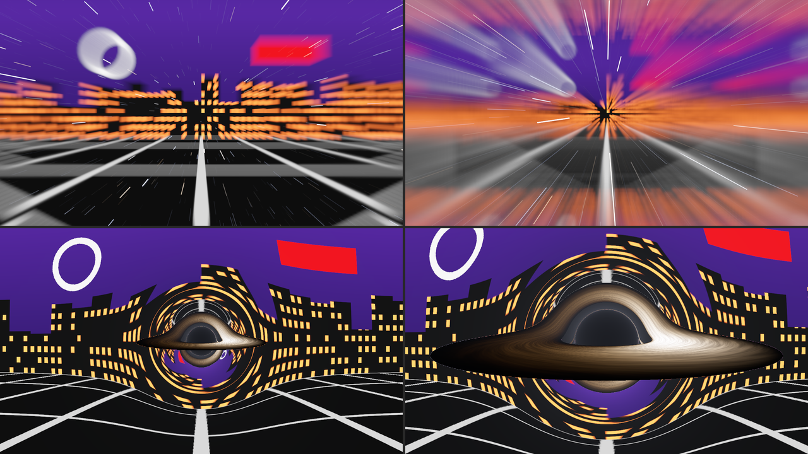

*SW Slip Over on the night-city card at its defaults, rendered by `sliptest` rather than captured
from Resolume. Top, Hyperspace at Journey 0.25 and 0.35, the clip's light smearing inward, more as
the camera speeds up. Bottom, the Black Hole at 0.40 and held at 0.5, the city bent round the
shadow. Each panel is a whole 1280 × 720 frame at half size.*

**In normal space the Over is your clip with the star field over it.** With **Stars** at 0 it hands
your clip back untouched, to the last bit of every pixel: the harness checks that in every look at
the default Cruise Speed, and I checked it at the fastest Cruise Speed too. The Black Hole has no
stars over the clip in normal space anyway. **Exposure**
doesn't touch your clip: it's the light of the stars and everything else the plugin makes.

---

## The Journey group

Resolume shows every slider as 0 to 1, except Stars, which is a whole number. The ranges below are
what the slider positions mean.

**Look** (*Hyperspace*, *Warp*, *Wormhole*, *Black Hole*; default *Hyperspace*). Which trip.

**Drive** (*Hold*, *Trip*, *Loop*, *Fader*; default *Loop*). How the trip is driven; see *The
trip*.

**Engage** (a switch, off by default). Under Hold: on goes in and stays, off comes out.

**Jump** (a button). Under Trip: one round trip, if you're in normal space when you press it.

**Journey** (0 to 1, default 0). Under Fader: where you are on the trip.

**Entry Time**, **Transit Time**, **Exit Time** and **Cruise Time** (0.2 to 20 seconds each;
defaults 2, 3, 1.5 and 3 seconds). How long going in takes, how long Trip and Loop stay in transit,
how long coming out takes, and how long Loop waits in normal space between trips. The sliders are
geometric (each quarter of the way along multiplies the time by a little over three):

| seconds | 0.5 | 1 | 1.5 | 2 | 3 | 4 | 6 | 8 | 10 | 16 | 20 |
| --- | --- | --- | --- | --- | --- | --- | --- | --- | --- | --- | --- |
| slider | 0.199 | 0.349 | 0.4375 | 0.5 | 0.588 | 0.651 | 0.739 | 0.801 | 0.849 | 0.952 | 1 |

The scripts stretch to fit the times, so a longer Entry Time is the same entry, slower. The flashes
keep their own fade times whatever the trip's.

---

## The Flight group

**Cruise Speed** (0, then 0.005 to 2 field depths a second, geometrically; default 0.08, at 0.463).
How fast the stars drift towards you in normal space. At the default the camera takes twelve and a
half seconds to fly the depth of the box of stars. At 0 they stand still, and a jump still works,
from rest. In transit it's added to the look's own speed.

**Top Speed** (a tenth to ten times the look's own transit speed, geometrically; default 1, at the
middle). Hyperspace's transit is fast, Warp's under a quarter of that and the Wormhole's a sixth.
Turn Warp's right up and it's faster than Hyperspace at its default, steady lines and all; turn
Hyperspace's down and its lines break into separate streaks.

**Heading X** and **Heading Y** (0 to 1, default 0.5 each). Where the vanishing point is: 0 is the
left (or bottom) edge of the frame, 1 the right (or top), 0.5 the middle. Everything follows it:
the streaks, the flashes, the rubber band, the whirlpool, the tunnel and the black hole.

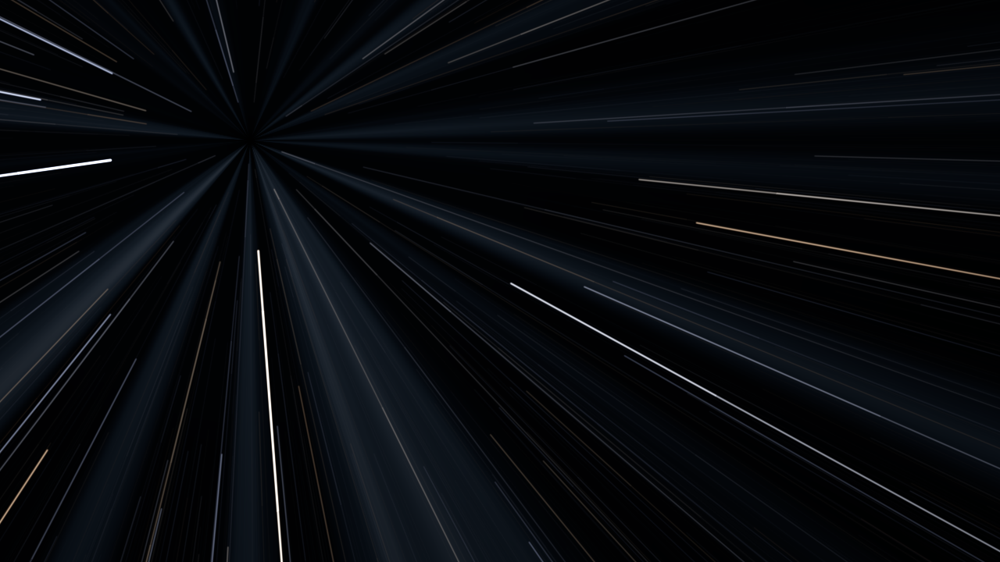

*Hyperspace at Journey 0.40 with Heading X 0.25 and Heading Y 0.75. SW Slipstream, otherwise at its
defaults, rendered by `sliptest` rather than captured from Resolume.*

**Field of View** (20° to 120° from the top of the frame to the bottom; default 60°, at 0.4). The
star field is built to fill whatever view you pick, but a wider view spreads the same stars further
out, so it's dimmer: at rest, the average pixel at 120° is about 40% darker than at 20°. It also changes everything
with a shape: the tunnel's and the clouds' perspective and, above all, the Black Hole. Hole Size is
the shadow's share of the view, so a wider view keeps the shadow the same size on screen by putting
the camera nearer the hole, and the disc and the bent sky round it fill much more of the frame. At
wide views the black hole's sky is soft, each star spread over a bigger patch.

**Shutter** (0° to 360°; default 180°). How much of each frame the shutter is open for, as in a film
camera. Longer streaks, same light: a star lays the same light along a longer line, because the
exposure follows the shutter the way a camera on auto exposure would. At 0° there are no streaks at
all, even at full speed, only points jumping about from frame to frame. The shutter is a share of
each frame, so at 30 fps every streak is twice as long as at 60. The trip itself is timed in
seconds and doesn't change with the frame rate.

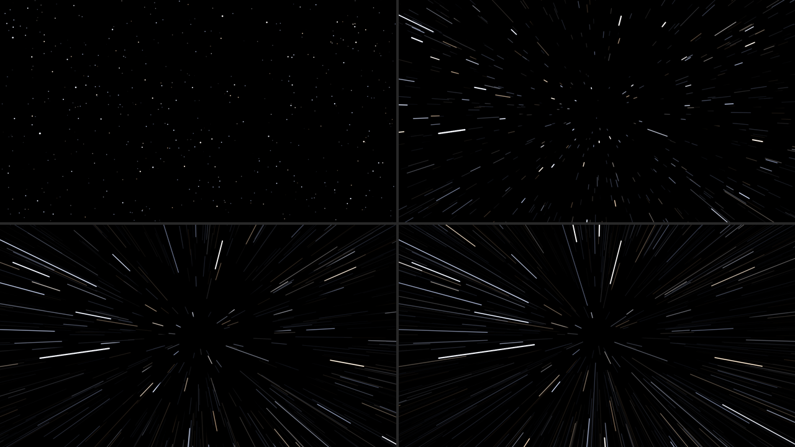

*Hyperspace at Journey 0.30, SW Slipstream otherwise at its defaults, rendered by `sliptest` rather
than captured from Resolume. Top left 0°, top right 45°, bottom left 180° (the default), bottom right
360°. Each panel is a whole 1280 × 720 frame at half size.*

Cruise Speed, Top Speed and Shutter do nothing in the Black Hole, whose camera never moves.

---

## The Light group

**Stars** (0 to 20,000, a whole number; default 4,000). How many stars are in the box, and in the
Black Hole how densely the sky is filled. A few are blinding and most are faint, as in the real
sky. At 0 Hyperspace is only the tunnel, and the Black Hole only the shadow, the disc and the corona.

**Star Colour** (0 to 1, default 0.6). 0 is every star white; 1 is each star its own blackbody
colour, from orange at 3,000 K to blue-white at 30,000 K. It's subtle, since the bright stars burn
out white in the middle anyway, and shows mostly in the fringes and the faint streaks.

**Exposure** (−4 to +4 stops; default 0, at the middle). The light of the stars, the sky, the
tunnel, the clouds, the disc, the corona and the Wormhole's white-out; each stop doubles it. More
exposure doesn't lengthen the streaks, it brings up more of the faint ones and burns more of the
bright ones out white. It doesn't touch your clip in the Over, or the flashes.

**Flash** (0 to 1, default 0.7). How bright the flashes are. Hyperspace has a blue-white wash over
the frame, brightest at the vanishing point, going in and again dropping out; Warp a core, ring and
horizontal streak at the snap and on arrival; the Wormhole a white flash of the whole frame at the
end; the Black Hole the white hole. At 0 there are none, and the Black Hole's plunge ends in a cut
from black to the stars. The Wormhole's white-out isn't a flash, so it's still there at 0, fading
away as it always does. See *Flashes*.

**Tint** (0 to 1, default 0.6). A pale colour round the hue wheel: red at 0, gold at 0.1, green at a
third, cyan at a half, blue at the default, violet past three quarters and red again at 1. It
colours the Hyperspace tunnel, the Wormhole's clouds and a third of the Warp flash.

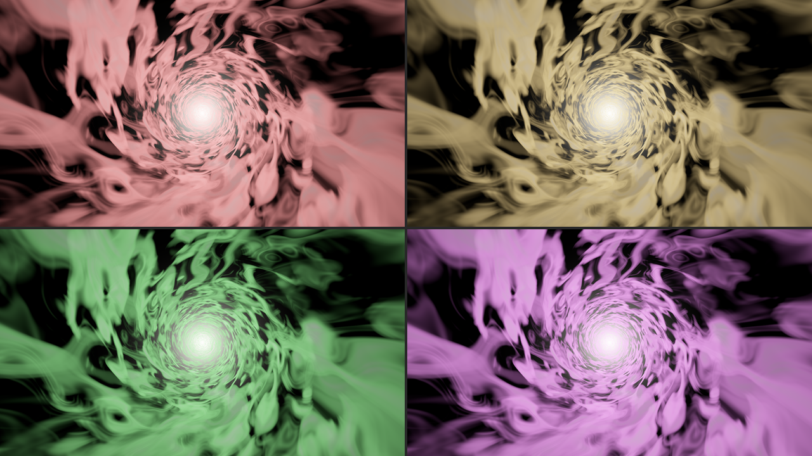

*The Wormhole in transit at Tint 0, 0.1, 0.33 and 0.83, SW Slipstream otherwise at its defaults,
rendered by `sliptest` rather than captured from Resolume. Each panel is a whole 1280 × 720 frame at
half size.*

---

## The look groups

Each look has a group of its own. They're all there whichever Look is chosen, and each only does
anything in its own look.

### Hyperspace

**Tunnel** (0 to 1, default 0.6). How bright the tunnel is. At 0 there's no tunnel, only the lines.
It's only ever there around transit, from Journey 0.375 to 0.575.

### Warp

**Stretch** (0 to 1, default 0.75). How hard the rubber band pulls. At 0 there's no rubber band, and
the snap comes out of an undisturbed picture; at 1 the middle of the picture is pulled nearly all
the way in before it snaps. It also sets how far the middle bulges out as the picture settles on
arrival.

**Dispersion** (0 to 1, default 0.4). The warp streaks' colour split: each streak's blue runs further
out than its red, so the outer end goes from white through cyan to blue. At 0 each streak is one
colour.

### Wormhole

**Swirl** (0 to 6 turns at the middle; default 3, at 0.5). How hard the picture twists into the
whirlpool going in and unwinds coming out, strongest at the vanishing point and dying away
outwards, and how fast the clouds spin in transit. At 0 the picture doesn't twist, the mouth opens
straight out of it, and the clouds have no spin of their own, only rushing past.

**Clouds** (0 to 1, default 0.75). How thick the cloud is. Thinner cloud shows more of the dark
between the layers; at 0 there's only the glow at the far end, on black.

### Black Hole

**Hole Size** (0.05 to 0.9 of half the view, measured as an angle; default 0.3 on the slider). How
big the shadow is when the hole is held: at the default 60° view, the default is a shadow about 200
pixels across at 720p. A bigger shadow is a hole seen from nearer, so the disc and the bending round it
grow faster than the shadow does; at 0.7 the disc runs off the bottom of the frame.

**Disc** (0 to 1, default 0.8). How bright the accretion disc is. At 0 there's no disc, which shows
the shadow, the corona and the bent sky on their own.

**Disc Tilt** (0° face on to 90° edge on; default about 84°, at 0.93). At 0 you look down on the disc,
a wide ring round the shadow. Towards 90° it closes to the brim across the middle, its far side bent
up over the shadow and under it. At 90° the disc itself is a line too thin to see, and what's left
is its far side's lensed image, a ring round the shadow.

**Disc Size** (0 to 1, default 0.4). How far out the disc reaches, from a narrow ring hugging the hole
(its outer edge a third further out than its inner one) to a disc whose outer edge is nearly seven
times as far out as its inner one. The inner edge never moves: nothing can orbit closer than that.

**Disc Heat** (2,000 K to 40,000 K at its hottest, geometrically; default 4,500 K, at 0.27). The
disc's colour: orange at the bottom, pale gold at the default, white at the middle (about 9,000 K),
blue-white at the top. The hotter it is, the less lopsided it looks, because a very hot thing's
light changes less with the Doppler shift.

**Doppler** (0 to 1, default 1). How much of the Doppler shift the disc gets. At 1 the side coming
towards you, the right-hand side at the defaults, is bluer and many times the brighter. At 0 the
disc is mirror-symmetric, which the harness checks to the last bit.

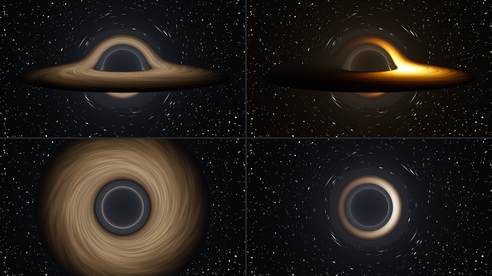

*The Black Hole held (Journey 0.5), SW Slipstream otherwise at its defaults, rendered by `sliptest`
rather than captured from Resolume. Top left, Doppler 0. Top right, Disc Heat 0 (2,000 K): orange,
and far more lopsided. Bottom left, Disc Tilt 0, face on. Bottom right, Disc Tilt 1, edge on. Each
panel is a whole 1280 × 720 frame at half size.*

**Corona** (0 to 1, default 0.35). How bright the glow round the hole is. The glow is in front of the
horizon as well as round it, so it lights the inside of the shadow faintly too; at 0 the shadow is
black. Turn it up with Disc at 0 to see the photon ring on its own.

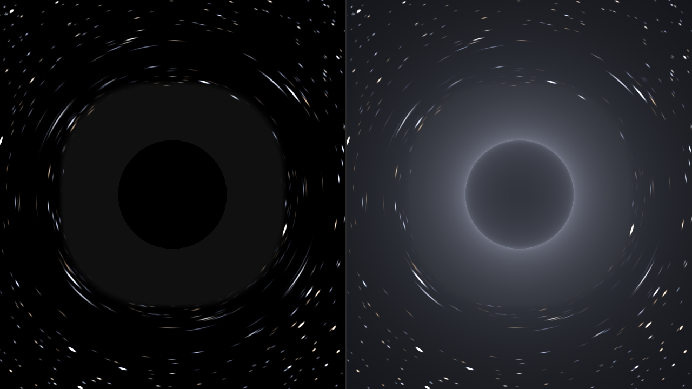

*The Black Hole held with Disc 0: left Corona 0, right Corona 1. SW Slipstream otherwise at its
defaults, rendered by `sliptest` rather than captured from Resolume; each panel is the middle 638 ×
720 of a 1280 × 720 frame. On the left, the sky round the shadow is bent too hard for single stars to
be drawn, so it's drawn as its average light: the flat grey ring. On the right, the corona,
brightest in the photon ring on the shadow's edge.*

---

## The Clip group (SW Slip Over only)

**Clip Depth** (0.02 to 2 field depths ahead, geometrically; default 0.3, at 0.588). How far ahead
of the camera your clip rides in Hyperspace, the only look it affects. Nearer smears more: at 0 the
clip smears into radial bands of its own colours as soon as you move; at 1 it hardly smears until
you're nearly at full speed.

**Clip Through** (0 to 1, default 0.25). How much of your clip you can still see in transit: in
Hyperspace, how far its smear fades as the tunnel comes up; in Warp, how much of it stays behind the
streaks while the picture has gone into the vanishing point; in the Wormhole, how much of its colour
goes into the clouds. At 0 transit is all stars, tunnel or cloud; at 1 your clip carries on at full
strength. It does nothing in the Black Hole, where your clip is the sky the whole way.

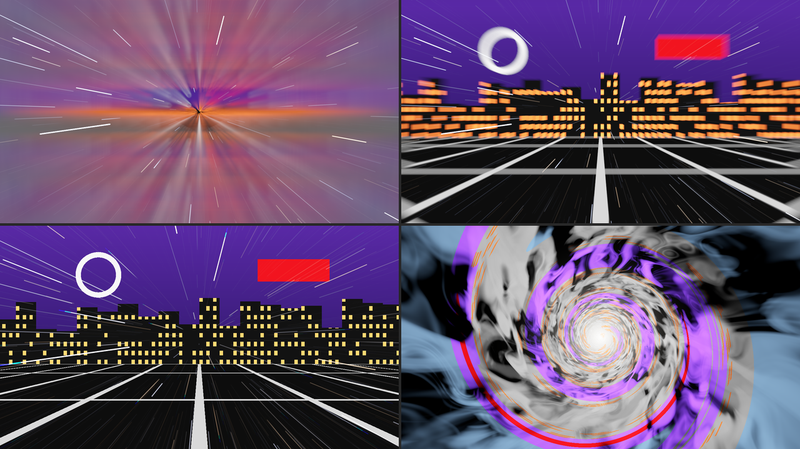

*SW Slip Over on the night-city card, otherwise at its defaults, rendered by `sliptest` rather than
captured from Resolume. Top, Hyperspace at Journey 0.30 with Clip Depth 0 (left) and 1 (right).
Bottom, Warp and the Wormhole in transit with Clip Through 1. Each panel is a whole 1280 × 720 frame
at half size.*

**Mix** (0 to 1, default 1). The whole effect against your clip. At 1 the output is opaque whatever
your clip's alpha; at 0 your clip comes back untouched, alpha and all.

---

## Flashes

Every look has a moment where most of the frame changes brightness at once, and on a big LED wall
that's a lot of light. Measured through the offline harness (320 × 180, 60 fps, one trip at the
defaults under Loop) as the whole frame's average light, 0 for black and 1 for white:

| look | brightest frame | biggest change between two frames | with Flash at 0 |
| --- | --- | --- | --- |
| Hyperspace | 0.40 | 0.30, at the drop-out flash | brightest 0.12, biggest change 0.02 |
| Warp | 0.15 | 0.10, at the snap | brightest 0.07, biggest change 0.02 |
| Wormhole | 1.00, over half-white for 0.9 s | 0.13, as the white-out grows | brightest 1.00, biggest change 0.13, over half-white for 0.37 s |
| Black Hole | 0.95 | 0.67, black to the white hole | brightest 0.27, biggest change 0.08 |

They come once or twice a trip, so they're flashes rather than a flicker, but the white hole goes
from black to most of the way to white in one frame, and the Wormhole fills the whole frame with
white for a moment whatever Flash says.

- **Flash** at 0 takes the flashes out of all four looks.
- **The Wormhole's white-out isn't a flash**, so Flash doesn't remove it. At Flash 0 it rises to
  white over about seven frames, holds for nine and fades over sixteen, with no cut. **Exposure**
  dims it: at −4 stops with Flash at 0, its brightest frame measured 0.41 rather than 1.00. Or turn
  the layer down in Resolume, or use another look.

None of this was measured inside Resolume or on any output but the harness's. Check before it goes
to a broadcast feed or a big screen in front of an audience.

---

## The source is transparent where space is empty

SW Slipstream's output is premultiplied: empty space is transparent, and a star, a streak or the
tunnel is as opaque as it is bright, so the layer goes over whatever is below it. The black hole's
shadow and disc are opaque, and so is the plunge's fade to black, which blacks out the layers under
it too. Use it on Add or Screen for stars over a picture.

---

## Recipes

**A jump on cue.** Drive *Trip*, and map **Jump** to a MIDI note or a button: each press is one round
trip. For a jump that hangs in transit until you say so, use *Hold* and map **Engage**: on to go, off
to come back.

**Bars, not seconds.** There's no beat sync, but you can set the times to bars. A bar of four is 240 ÷
BPM seconds, two at 120 BPM: Entry 0.5 (2 s, one bar), Transit 0.801 (8 s, four bars), Exit 0.5 (one
bar) and Cruise 0.651 (4 s, two bars) make an eight-bar loop. Three decimal places only get within a
few thousandths of a second of 4 and 8, so it runs about 8 ms a cycle long: in the harness, ten times
round, it was less than a tenth of a second behind the bar. It isn't locked to Resolume's tempo, Loop
counts from the plugin's first frame, and I haven't tried what a retriggered clip does to it in
Resolume.

**Scrubbing it by hand.** Drive *Fader*, and put **Journey** on a fader. The tables under each look
say where everything is. A ramp on Journey can loop: at the wrap from 1 back to 0 it carries straight
on into the next trip, so a looping 0-to-1 ramp is a Loop that goes at the ramp's pace, with no time
in normal space between trips.

**A hyperspace jump out of your own picture.** SW Slip Over on the clip, Look *Hyperspace*, Drive
*Trip*, Clip Depth 0.4 for a smear that eats the picture properly, Clip Through 0 so transit is all
stars and tunnel, and Tunnel 0.8. On the way out the clip comes back out of the lines.

**Warp to the next clip.** SW Slip Over on the layer rather than the clip, so it stays put when the
clip changes. Look *Warp*, Drive *Trip*, Clip Through 0. Press Jump and switch clips while you're at
warp: at the default times, anywhere from about a second and a half after the press, once the snap
has taken the old clip away, to about five seconds after, when you arrive. The new clip bursts out
of the vanishing point. (That's what the harness did with the picture under the effect changed
halfway through transit. I haven't tried it in Resolume.)

**A slow approach.** The Black Hole with Drive *Hold*, Entry Time 0.849 (10 s), Hole Size 0.45 and
Disc Tilt 0.9. Engage, and the hole comes in over ten seconds and stays. Doppler 0 and Disc Heat 0.4
(about 6,600 K) for the even, pale disc the film went for, and Field of View 0.6 (80°) to make it loom
over the bottom of the frame. Switch Engage off for the plunge.

**Stars for a backdrop.** SW Slipstream with Drive *Hold* and Engage off stays in normal space: a
slow star field. Cruise Speed 0.6 (about 0.18 field depths a second), Shutter 1 (360°) so the
nearest stars draw short trails, and Stars 8,000. Heading Y 0.6 lifts the vanishing point above the
horizon of whatever's on the layer below.

---

## Time comes from the host

The trip, the camera, the whirlpool and the disc all run on Resolume's clock. Each frame they move
on by the host's time since the last, so when the host's clock stops, everything stops, and a jump in
the clock, backwards or more than a second forwards, passes no time. For the first few frames after
it loads, while it works out whether the host counts in seconds or milliseconds (Resolume has been
seen to send both), the plugin runs on a steady clock of its own. Time is kept in double precision,
because Resolume's clock grows to hundreds of millions of milliseconds, where a float can't tell one
frame from the next; the harness checks every frame's step at 499,000 seconds in. Changing the
composition's size mid-trip carries on where it was.

---

## How it works

Every host frame:

1. **The trip**, on the CPU: where Journey is at the start and end of the frame, and the look's
   script at both, so anything that moves during the frame (the rubber band, the snap, the
   whirlpool) is blurred by the shutter along with the stars.
2. **The camera**, on the CPU: how far it flew while the shutter was open.
3. **The flash**, if the trip passed one of the look's flash points, averaged over the open shutter.
4. **The stars**, on the GPU: one quad per star, covering its streak, and the streak's light worked
   out in closed form, its blur and its two ends included, whether it's a point or half the frame
   long. Where a long shutter sees the same star more than once, each pass is counted.
5. **The scene**, on the GPU: the clip's smear, the rubber band, the whirlpool and the clouds, or the
   black hole, where each pixel's ray is followed round the hole using a table of light paths worked
   out once when the plugin loads.
6. **Development**, as film: everything so far is exposure, turned into a picture at the end, with
   the flash and the plunge's blackout on top, then Mix in the Over.

---

## Performance

Measured by the offline harness (`sliptest --bench`) on an Apple M4 Max, the median frame timed with
`glFinish` both sides:

| plugin | moment | 720p | 1080p | 4K |
| --- | --- | --- | --- | --- |
| SW Slipstream | Hyperspace, normal space | 0.34 ms | 0.58 ms | 1.93 ms |
| SW Slipstream | Hyperspace, in transit | 0.56 ms | 1.05 ms | 3.53 ms |
| SW Slip Over | Hyperspace, jumping | 0.71 ms | 1.26 ms | 4.51 ms |
| SW Slip Over | Warp, the rubber band | 0.63 ms | 1.02 ms | 3.64 ms |
| SW Slipstream | Wormhole, in transit | 1.46 ms | 2.93 ms | 10.85 ms |
| SW Slip Over | Black Hole, held | 0.79 ms | 1.50 ms | 5.12 ms |

Wormhole aside, that's under a tenth of a 60 fps frame at 720p and 1080p, and up to about a third
at 4K. The Wormhole's clouds are three layers of noise bent through more noise at every pixel,
which costs about two thirds of a 60 fps frame at 4K. These are the README's figures, measured on a
quiet machine just before the last fixes went in; timed back to back with the build before them on a
busy machine, the released build came out within a quarter either way in every row, with no
pattern. Nothing was timed inside Resolume, and nothing was timed on Windows.

---

## If it looks wrong

**The Wormhole's clouds flicker at the edges of the frame in transit.** Out there the clouds are
close and rush past faster than any shutter can blur, so one frame's clouds look little like the
next's. It's a known limit of this release. Top Speed at 0 (a tenth of the default) steadies them.

**Fine rings and spokes at the vanishing point in Hyperspace.** The tunnel's pattern aliases there
with Tunnel up and a short Shutter or a low Top Speed. Open the Shutter, turn Top Speed up, or turn
Tunnel down.

**Stars vanish as they swirl in the Wormhole.** That's the Wormhole's cheat with the stars: a streak
the whirlpool would bend too far to draw straight fades out instead.

**A flash and a frame of streaks out of nowhere, under Fader.** Journey jumped by a big step in one
frame, so that whole stretch of the trip, flashes and all, went by in one frame. A jump forwards is
always taken literally, so 0.1 to 0.9 flies the entry, transit and the drop-out in a frame. A jump
back of up to half a trip runs backwards; one further back than that goes on round instead, so 0.9
to 0.1 is a short step forwards through normal space and shows nothing. Move it more slowly, or let
a ramp do it.

**It never goes anywhere.** Drive is *Hold* with Engage off, *Trip* waiting for Jump (which is
ignored during a trip), or *Fader* with Journey at 0.

**The streaks are dots.** Shutter is at or near 0°.

**Hyperspace's lines have gaps in them.** Top Speed is below about 0.41. Turn it up, or open the
Shutter.

**The Over's clip is covered in stars.** That's the star field in front of it. Stars 0 for your clip
on its own in normal space.

**The shadow isn't black.** That's the corona in front of it. Corona 0 makes it black.

**The disc runs off the frame.** Hole Size or Field of View is up, which puts the camera nearer the
hole. Turn one of them, or Disc Size, down.

**Neither plugin is in the browser.** Check the folder under *Installing*, and that Resolume was
restarted.

**It does nothing at all.** That's what a shader that won't compile looks like. The error is in the
log:

```
macOS    ~/Library/Logs/slipstream/slipstream.YYYY-MM-DD.log
Windows  %LOCALAPPDATA%\slipstream\logs\slipstream.YYYY-MM-DD.log
```

It records the GL vendor, renderer and version at load, which shader failed if one did, and whether
the buffers couldn't be allocated.

---

## Known limits

- **Never loaded into Resolume on macOS**, only into `oxbow`. For Windows, see the box at the top.
- **On a Mac, only ever run on an Apple M4 Max** and Apple's software renderer, although the macOS
  build has an Intel slice.
- **The Wormhole's clouds flicker at the frame's edges in transit** at the default Top Speed, where
  they run past faster than the shutter blurs. A tenth of the speed (Top Speed 0) steadies them.
- **The Hyperspace tunnel aliases** into fine rings and spokes at the vanishing point with Tunnel up
  and a short Shutter or a low Top Speed.
- **The Wormhole's stars fade** where the whirlpool would bend a streak too far to draw straight:
  the one cheat with its stars.
- **The black hole doesn't spin.** A spinning one has a lopsided shadow and drags space round with
  it, which needs a much bigger table of light paths. The disc spins; the hole doesn't.
- **The plunge and the white hole are cheats.** The camera stops just outside the photon sphere,
  where the shadow already covers half the sky, and everything after that is a fade to black and a
  flash.
- **Hyperspace never brings your clip any nearer**: the one cheat in the smear.
- **The black hole's sky** is built on a grid wrapped round a cube. Stars on the seams between its
  faces are drawn whole, but that was checked by eye on a render at 120°, and nothing measures it.
- **No beat sync and no audio input.** Map Jump or Engage to a cue, or set the times in bars.
- **The looks were judged by eye** on the harness's renders, and the only clip they've been measured
  on is the harness's test card.
- **No presets and no OpenFX version.**

---

## About

The last group, **About**, has the plugins' name, version, licence and maker, and buttons that open
this guide, the project page, the source on GitHub and the support page in your browser.

## Links

- Project page: [stoatworks-labs.com/software/slipstream](https://stoatworks-labs.com/software/slipstream/)
- Source: [github.com/stoatworks-labs/slipstream](https://github.com/stoatworks-labs/slipstream)
- User guide: [stoatworks-labs.com/software/slipstream/guide](https://stoatworks-labs.com/software/slipstream/guide/)

## Reporting something

If something's wrong, shout at
[github.com/stoatworks-labs/slipstream/issues](https://github.com/stoatworks-labs/slipstream/issues).
A screenshot, the Look, the Drive, where Journey was, any other controls you moved, and the
composition's resolution and frame rate are usually enough. If the plugin did nothing, attach the
log.

The black hole follows Schwarzschild (1916) and Synge (1966), and the disc Shakura and Sunyaev
(1973); the full list of the work it stands on is in
[ATTRIBUTIONS.md](https://github.com/stoatworks-labs/slipstream/blob/main/ATTRIBUTIONS.md).
